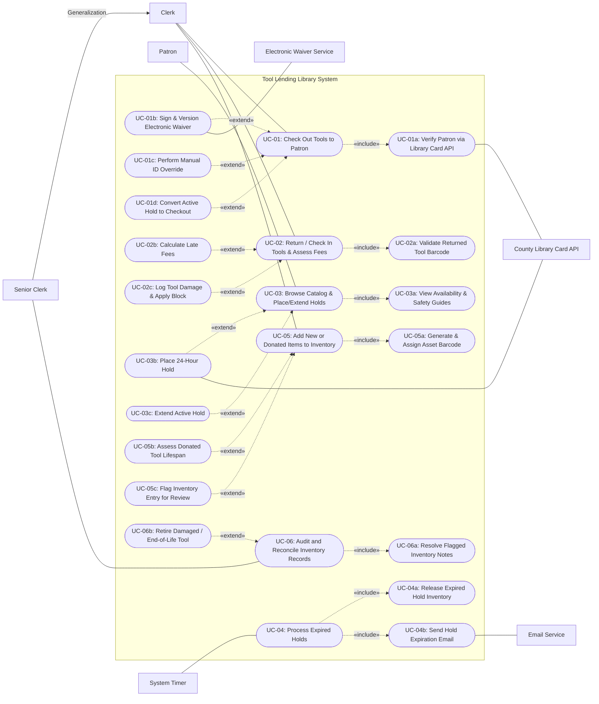
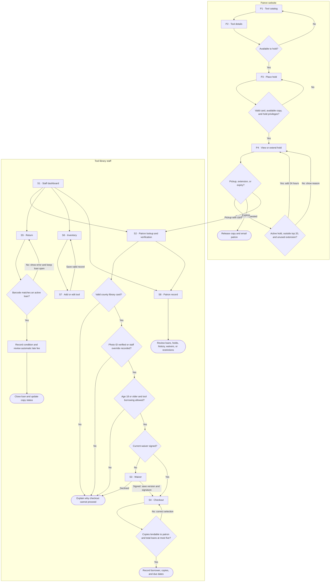

# Functional Spec

## Overview
This document is a draft-functional specification for a proposed system for a County Library to extend services to include a tool library.

The document is broken up into the follow sections in this order:
1. User Scenarios
2. Non-goals
3. Use case diagram
4. Use cases
5. UX Flow
6. User Screens


## User Scenarios for Tool Library

### Debby - The Remodeler
Debby is a long-time resident of the county and frequent user for the county library. 
Debby needs to borrow an electric-powered router to profile the of their wooden counter top in their ongoing DIY kitchen renovation.
Debby has never used a router before, but she is recommended some videos and reading material on the safe operation of the equipment.
She supplies adequate ID and checks the tool out for a week. She returns the tool in working condition, although she admits that a router can be a scary tool.

### Franklin - No ID
Franklin is a local homeless man who means well and is kind to library staff.
Franklin has a successful history of borrowing and returning tools in working order and never once late.
However, the instability of his life catches up to sometimes, in this case it manifests and him losing his ID but desperately needing
tools to fix his adhoc shelter. The library working on the tool library at the time knows Franklin well enough and decides to waive the requirement for ID and instead checks out Franklin out by manually search for his details and entering his details via an override path.
Franklin returns the tool three days later, grateful for the exception and sympathy.

### Roy - Tool Collector
Roy is a general contractor who owns a lot of tools, but is also a very disorganized business owner.
Roy realizes on the drive to a client's home that he has misplaced his Skilsaw, presumably left back at the shop.
Instead of going to a hardware store, Roy thinks its a better idea to simply borrow a Skilsaw from the tool library till the next time he is coming this way for the client.
Four days later Roy returns, but inadvertently brought the Skilsaw that he personally owned which happened to be the same model.
Their personal Skilsaw was not checked in at it did not have a barcode. Roy returned the proper Skilsaw the next day.

### Roy - Generous
Roy really likes the tool library, it has saved his skin on a couple of jobs.
Because of this Roy decides to return the favor by donating his used tools every few months.
Library staff goes through the donations and confirms the working order, like most donations, they are in working order but the life left in them is limited.

### Dorthy - Library Clerk
Dorthy is a clerk for the county library and specifically handles the logistics of new acquisitions.
When and whether or not new books or items are purchased or accepted as donations primarily flows through her.
Dorthy has a well-oiled system for how she handles items and enters their details in the system. It isn't a great system as the systems the county uses for asset management is a hodge-podge of licensed software from 90s.
Nevertheless, Dorthy speedily and accurately enters all items into the system, even if the software is in EoL.

### Daryl - Filling in
Daryl also works at the county library, but he doesn't know a philips head from a flat head. When Dorthy goes on a much needed vacation he tries his best to fill her role. Luckily Dorthy has made a fair amount of documentation on the process, but the process is slow going and error prone. Daryl only enters half of what Dorthy would do in a day because the aging system is unintuitive. Daryl is conscious of the errors, and makes notes of apparent errors; when Dorthy returns from vacation they will both go through the errors together to rectify any mistakes.

### Paul - Catalog User
Paul is a frequent user of the tool library but he lives way out in the sticks. His typical flow for use was to call the library and ask if they had a particular tool in stock. This process is fine but ultimately recognized as unnecessary, so eventually the tool library creates a very simple catalog website. It's ugly, its not fast, it might be done because someone unplugged the old desktop running it, but when it does work it saves Paul a phone call and the staff from doing some customer service.

Paul uses the website and sees a hedge trimmer is available. He places a hold on it by entering his library card ID number when prompted by the simple HTML form at the bottom of the item page. When Paul goes to the library, he simply hands a clerk his card and the item on hold is retrieved and the checkout process is started.

### Saul - Delayed Retrieval
Saul is also a user of the online catalog, and puts a hold on an item that is very frequently borrowed. The intention is that the users of the catalog will checkout their within 24 hours of the hold, but Saul gets hung up and is unable to get to the library on time. One less 'hot' items Saul would be able to extend the hold one time for an additional 24 hours, but because this item is in the top 20 of most frequently checked out items, no extension is possible. Saul is  informed via email that his hold expired.

### Cathy - Late
Cathy borrowed a lot of tools, the max anyone is allowed at once which is five. One of them was a high demand item, one was very cheap, one ended up broken, and the remaining two were just normal and returned in working order, but all were returned 14 days late. The late fees were quite a bit, but luckily for the clerk the system calculated all the late fees automatically. The high demand item got the maximum late fee of 20$, the broken item also had the maximum fee of 20$ which is tracked on her account for clerks to see, the two normal items both got fees of 14$, and the cheap item only had a fee of 5$ as that was it's replacement cost.

### Billy - Teen
Billy is high schooler and pretty handy with tools, but he doesn't always have the all the tools he needs. Billy tries to use the tool library, but as a seventeen year hold he turned away by the clerks due to his inability to legally sign the waiver.

### Saul Goodman - Lawyer
Saul Goodman is the legal council of a user who was injured using a tool incorrectly. Saul Goodman alleges that the waiver was not signed by his client, nor is it clear what version of the waiver the client signed. Luckily for the library, the signature of all waivers are stored in durable cloud storage and the both the waiver and the record of the record waiver being completed are both versioned. Saul Goodman's outrageous legal strategy fails to defeat reliable and thoughtful document control.

### Rick - The Ghost Holder
Rick is a bit of a nuisance. He rarely actually uses the tool library, but he does extensively use holds in the catalog, in fact Rick is the reason the library staff found that that despite only being able to borrow five tools, the system originally allowed for reservations up to sixteen items. Fortunately for the community, V3 of the tool library and its catalog have terms of service to disallow for this exact behavior.
To resolve this matter, a library clerk uses a escalating restriction of privileges; first they lower his hold limit down to just one item at a time. After they they lower the frequency of holds to only allow for one hold every week. Finally if they still exhibit the behavior of acquiring holds but never actually exercising those holds, the library staff can simply revoke his use of the tool library all together.


## Non-goals

### Book Lending system
The tool library system will not handle book lendings or returns. There is already a system in place for this.

### Library Card System
The Library already has an existing API for its Library Cards. Constructing a new system for this is unnecessary

### Notification System
The client already has a text/email notification system and has requested we integrate with it. This project will not construct a standalone system for this.

### Library card scanning
Library cards are entered manually, so any software related to scanning is out of scope for this project.

### Automated Categorization
Some tools are given different late fees based on their category, however this categorization is done manually. Any automated handling of categorization is outside of the scope.

### ID Scanning, storage, verification
Staff visually inspect the photo ID of a borrower at checkout. Library policy is to not store or scan, and ID verification is in-person at the desk. Any system handling photo ID verification is not within the scope of this project.

### Mobile apps
The client has specifically requested a customer-facing website with staff functionality. No native mobile apps are necessary.


## Use Case Diagram



## Use Cases
### Refer to `User-Scenarios.md` for narrative understanding of Use Cases

#### UC-01: Check out tools to Patron
#### Primary Actor: Clerk
Secondary Actors: Library Card API, Waiver System

#### Preconditions
Clerk is authenticated to system
Tools being checked out are registered in system via valid barcodes.

#### Postconditions
Active loan record is inserted into database
Tool Inventory item status' updated to `Checked Out`

#### Primary Success Path
1. Patron presents their county library card and photo ID to Clerk
2. Clerk enters or scans library card into system
3. System queries the county library card system to retrieve Patron's name, contact info, standing, and other details
4. Clerk inspects Patron's Photo ID to confirm identity and age
5. System verifies Patron has fewer than 5 tools checked out currently
6. Clerk scans barcodes of each item to be borrowed, up to five items
7. System looks up each tool and their loan rules, such as the standard 2 week loan vs a shorter loan duration.
8. Clerk confirms checkout, loan record is created and inserted into database, and a receipt is handed to Patron

#### Extensions
1a. (Franklin Scenario) Patron forgot or lost photo ID.
    1a1. Clerk searches up the Patron manually by entering name or other details
    1a2. Clerk selects `Manual ID Override` for the purposes of logging a reason
    1a3.  System records override and proceeds to step 5
4a. (Billy Scenario) Patorn is under 18 years of age.
    4a1. Clerk flags/identifies the Patron is a minor.
    4a2. System blocks the checkout and displays an age-restriction notice; use case ends
5a. (Cathy Scenario) Patron has an unreturned and overdue tool
    5a1. System detects an unreturned tool that is overdue and checked out the Patron
    5a2. The system displays the Patron's damage/loss history and blocks new checkouts until resolved; use case ends.
5b. (Saul Goodman Scenario) Patron has not signed current waiver version
    5b1. System prompts Patron to review and sign the current electronic waiver
    5b2. System saves a timestamped, versioned signature to cloud storage and proceeds to step 6.
6a. (Cathy Scenario) Patron attempts to borrow more than 5 tools
    6a1. System rejects the 6th scan and alerts clerk that the 5 tool limit has been reached.

#### UC-02: Return / Check in Tools and Assesses Fees
##### Primary Actor: Clerk

##### Preconditions
Clerk is authenticated on system
Tool being returned is registered in the system with a valid barcode and currently has `Checked Out` as its status.

#### Postconditions
Active loan record is closed with a return timestamp
Item status is updated to `Available` or `Maintenance` or `Retired`
Any applicable late or damage fees are recorded on Patron's record

##### Primary Success Path
1. Patron brings one or more borrowed tools back to the Clerk for return
2. Clerk scans the barcode on the returned tool
3. System validates the barcode against active loan records and retrieves associated Patron profile and loan details, and confirms that tool is returned by the due date or one day grace period
4. Clerk physically inspects the tool and confirms it is in working condition
5. System closes the loan record, updates the tool status to `Available`

##### Extensions
2a. (Roy Scenario) Tool has no barcode or active loan record
   2a1. System rejects scan and alerts clerk that the item is unrecognized or not checked out
   2a2. Clerk declines to check in the personal/unmatched item and informs the Patron to return the library's barcoded tool; use case ends
3a. (Cathy Scenario) Tool is returned past due date + grace period
    3a1. System calculates the overdue days past the 1-day grace period and multiplies by the tool's daily rate ($1/day for standard tools, $3/day for high-demand tools)
    3a2. System caps the calculated late fee at the lesser of $20 or the tool's replacement value
    3a3. System displays the assessed late fee to the Clerk and records the balance on the Patron's account
4a. (Cathy Scenario) Tool is returned damaged or broken
    4a1. Clerk flags tool as damaged/broken and enters damage notes
    4a2. System assesses the damage fee, logs the damage incident on the Patron's profile for future clerks to see, and updates the tool status to Maintenance/Retired
4b. Tool is never returned
    4b1. System assesses the damage fee, logs the damage incident on the Patron's profile for future clerks to see, and updates the tool status to Maintenance/Retired
    4b2. System places a borrowing block on the Patron's tool library account until resolved, without affecting book borrowing privileges

#### UC-03: Browse Catalog and Place/Extend Holds
##### Primary Actor: Patron

##### Preconditions
#Public catalog web application is online and connected to the inventory database
#Patron holds a valid county library card number to place or extend a hold

#### Postconditions
If a hold is placed: Tool status is updated to `On Hold` for 24 hours and linked to the Patron's library card number
If a hold is extended: `Hold` expiration timestamp is extended by an additional 24 hours and marked as extended

##### Primary Success Path
1. Patron navigates to the online tool catalog website
2. Patron browses or searches available tools across branches and views tool availability, specifications, and attached safety videos/reading materials
3. Patron selects an available tool and enters their county library card number into the hold form
4. Patron selects an available tool and enters their county library card number into the hold form
5. System places a 24-hour hold on the tool, updates its status to `On Hold`, and displays hold confirmation details

##### Extensions
3a. Selected tool is currently `Checked Out` or `On Hold`
    3a1. System disables the hold form and displays the tool's current status/expected return date
4a. Invalid Library Card Entered
    4a1. County Library Card API returns no match
    4a2. System displayed an invalid card error and prompts Patron to reenter card number
5a. (Saul Scenario) Patron requests a 24-hour extension on an existing hold
    5a1. Patron selects the option to extend their active hold
    5a2. System verifies the hold has not already been extended once and checks whether the tool is in the Top 20 most frequently borrowed items
    5a3. System extends the hold expiration by 24 hours (48 hours total) and confirms the new pickup deadline
5b. (Saul Scenario) Patron attempts to extend a hold on a Top 20 high-demand tool or an already-extended hold
    5b1. System detects the tool is in the Top 20 most borrowed list (or has already used its one-time extension).
    5b2. System rejects the extension request and displays a notice that the original 24-hour deadline remains the same

#### UC-04: Process Expired Holds
##### Primary Actor: System Timer
###### Secondary Actor: Email Service

##### Preconditions
One or more active holds exist in the database with an expiration timestamp earlier than the current system time

#### Postconditions
Expired hold records are marked as `Expired`
Associated tools are returned to `Available` status in inventory
Expiration notification emails are dispatched to the affected Patrons

##### Primary Success Path
1. System Timer triggers the scheduled hold-expiration check
2. System queries the database for all active holds whose 24-hour (or 48-hour extended) pickup window has elapsed
3. System updates each expired hold's status to `Expired` and updates the corresponding tool's status from `On Hold` back to `Available`
4. System sends an automated email via the Email Service to each Patron's registered email address notifying them that their hold has expired
   
##### Extensions
2a. No active holds have passed their expiration timestamp
    2a1. System logs that zero holds expired and terminates the scheduled run
4a. Email Service fails to deliver notification
    4a1. System logs the delivery failure for retry while still releasing the tool back to `Available` status so inventory is not locked
    4a2. System appends email task to dead letter queue

#### UC-05: Add New or Donated Items to Inventory
##### Primary Actor: Clerk

##### Preconditions
Clerk is authenticated to the system with inventory management permissions
Physical tool has been purchased or donated and is ready for intake

#### Postconditions
New tool record is created in the inventory database with branch location, replacement value, fee tier, loan duration, and condition metadata
A unique asset barcode is generated, assigned, and attached to the tool

##### Primary Success Path
1. Clerk opens the guided tool intake form in the system.
2. Clerk enters the tool's name, category, branch location, replacement cost, late-fee tier (standard $1/day vs. high-demand $3/day), loan duration 2-week standard or custom shorter duration), and optionally links to safety materials
3. System validates that all required fields are populated and generates a unique asset barcode
4. Clerk prints/affixes the barcode to the physical tool and confirms saving the record
5. System inserts the new tool into the inventory database with status `Available`
   
##### Extensions
1a. (Roy Generous Scenario) Tool is acquired via Patron donation rather than purchase
    1a1. Clerk inspects the donated tool to confirm it is in safe working order
    1a2. Clerk selects `Donated` as the acquisition source and assigns a remaining-lifespan/condition rating
    1a3. System saves the condition rating alongside the tool record and proceeds to Step 3
1b. Donated tool fails safety or working-order inspection
    1b1. Clerk rejects the donation; item is not entered into the inventory database; use case ends
3a. (Daryl Scenario) Clerk is unsure about tool categorization, fee tier, or entry details
    3a1. Clerk checks the Flag for Review option and enters explanatory notes detailing the uncertainty
    3a2. System saves the tool record with a Needs Audit flag attached for senior clerk review

#### UC-06: Audit and Reconcile Inventory Records
##### Primary Actor: Senior Clerk (Dorthy)

##### Preconditions
Senior Clerk is authenticated to the system
One or more inventory records exist with a `Needs Audit` flag or require lifecycle retirement

#### Postconditions
Flagged inventory records are corrected and their `Needs Audit` flags are cleared
Retired/worn-out tools are updated to `Retired` status while preserving historical loan records

##### Primary Success Path
1. Senior Clerk opens the Inventory Audit queue
2. System displays a list of all inventory records flagged with `Needs Audit` along with the notes left by the entering clerk
3. Senior Clerk selects a flagged record, reviews the notes, and updates any incorrect fields (e.g., category, fee tier, replacement cost, or loan duration)
4. Senior Clerk clears the `Needs Audi`t flag and saves the updated record
5. System updates the inventory record and removes it from the audit queue

##### Extensions
2a. Audit queue is empty
    2a1. System displays a message indicating no inventory records are currently flagged for review
3a. Senior Clerk determines a tool (such as an aging donation or damaged item) has reached the end of its usable life
    3a1. Senior Clerk marks the tool status as `Retired` and enters a retirement reason
    3a2. System removes the tool from active catalog availability while retaining its past checkout and damage history for reporting

## UX Flow


### Rules and design assumptions

- Holds last 24 hours. Eligible holds can be extended once for another 24 hours. Tools in the top 20 by checkout frequency are ineligible. The design assumes patrons can open a hold-specific link to review or request an extension.
- Staff can start a walk-in checkout from the dashboard. The photo ID override follows Franklin's scenario. Staff still verify the library card, age, borrowing privileges, and waiver.
- Each copy has its own barcode. Checkout shows each copy's due date based on its lending period of up to two weeks. Staff can share safety resources when available.
- Return fees follow the initial Q&A: one-day grace period (or until closing on the next open day), then $1 per day for standard tools or $3 per day for high-demand or large tools, capped at the lower of $20 or replacement value. Cathy's scenario does not state how the grace period was applied. The wireframe uses the initial Q&A rule and leaves damage charges unspecified.
- The patron record supports individual hold limits, hold frequency limits, and tool borrowing restrictions. Unreturned tools can block further tool borrowing while book borrowing remains available. The Q&A gives both a general fee cap and a replacement-value example for unreturned tools, so the unreturned-item charge needs clarification.
- Location appears in catalog and inventory so additional tool branches can be added later.
  
## Tool Lending Library Page Wireframes

These low-fidelity layouts cover every page in the [UX Flow](UX-Flow.md). Brackets indicate controls. Error and confirmation messages appear on the page where the action occurred.

### P1 · Tool catalog

```text
 TOOL LENDING LIBRARY                              [View a hold]
 [Search tools_________________] [Search]

 [Category v]  [Location v]  [Available now □]

 TOOL                 AVAILABILITY       LOCATION
 Hedge trimmer         Available          Tool Library    [Details]
 Tile saw             Checked out        Tool Library    [Details]

 No matches: Change filters or try a different search.
```

### P2 · Tool details

```text
 [Back to catalog]
 HEDGE TRIMMER
 Available for pickup at Tool Library
 Loan period: 7 days

 [Tool photo]      Description and usage information
                  [Safety guide]  [Training video]

 [Place hold]
```

When no copy is available, show the current availability and a link back to search.

### P3 · Place hold

```text
 [Back to tool details]
 PLACE HOLD · HEDGE TRIMMER
 Pickup: Tool Library
 Pickup window: 24 hours

 Library card number [___________________]
 [Confirm hold]

 Status: Card could not be verified. Check the number and retry.
```

Use the same status area if the copy becomes unavailable or the patron has reached a hold limit. A successful request opens P4.

### P4 · View or extend hold

```text
 HOLD CONFIRMED · HEDGE TRIMMER
 Status: Ready for pickup
 Pick up by: Tuesday, 3:30 p.m.
 Pickup: Tool Library
 Bring your county library card and photo ID.

 [Extend by 24 hours]                       [Back to catalog]
```

Show the revised deadline after an extension. Show the reason when an extension is unavailable. An expired hold displays its status and a link back to the catalog. The catalog's **View a hold** entry assumes a hold lookup or hold-specific link.

### S1 · Staff dashboard

```text
 TOOL LIBRARY STAFF                         Location [Tool Library v]

 [Start checkout]       [Process return]
 [Find patron]          [Manage inventory]
```

### S2 · Patron lookup and verification

```text
 [Dashboard]  CHECKOUT · FIND PATRON
 [Scan card]  Card number [____________] [Look up]
 [Search patron by name]

 Patron: Paul Example                  County card: Valid
 [ ] Photo ID verified                 [ ] Age 18 or older confirmed
 [Record photo ID override]            [View patron record]

 Active loans: 2 of 5                  Tool borrowing: Allowed
 Ready holds: Hedge trimmer             Waiver: Current

 [Continue checkout]
```

Manual search locates a patron record for staff verification. Display the reason if the card, age, or tool borrowing status prevents checkout. If the waiver is missing or outdated, continue to S3.

### S3 · Waiver

```text
 [Back to verification]
 TOOL LENDING WAIVER                        Version [current version]
 Patron: Paul Example

 +----------------------------------------------------------------+
 | Waiver text                                                    |
 |                                                                |
 +----------------------------------------------------------------+
 [ ] I accept this waiver
 Electronic signature [________________________]

 [Save signature and continue]      [Decline and end checkout]
```

Store the signed record with the version of the waiver the patron accepted. Prompt again when a new version is required.

### S4 · Checkout

```text
 [Dashboard]  CHECKOUT · PAUL EXAMPLE
 Active loans: 2 of 5                 Remaining slots: 3
 [Scan tool]  Barcode [____________] [Add]

 COPY       TOOL              SOURCE          DUE DATE        ACTION
 T-104      Hedge trimmer      Ready hold      Nov 27          [Remove]

 [View safety resources]   [Confirm checkout]
 Status: Checkout complete. Hedge trimmer due Nov 27.
```

Show a copy-specific error if a barcode is invalid, the copy is unavailable to this patron, or the selection would exceed the five-tool limit.

### S5 · Return

```text
 [Dashboard]  RETURN
 [Scan tool]  Barcode [____________] [Look up loan]

 TOOL: Hedge trimmer · T-104           BORROWER: Paul Example
 Due: Nov 27                          Returned: Nov 29
 Condition [Working v]                Damage notes [____________]

 Late fee
 Grace period: [calculated from due date and open days]
 Billable late days: [calculated]      Total: [calculated]

 [Confirm return]
```

If the barcode is missing or fails to match an active loan, show an error and keep the loan open. Record reported damage on the patron history and update the copy status after return.

### S6 · Inventory

```text
 [Dashboard]  INVENTORY                           [Add tool]
 [Search name or barcode________] [Search]
 [Location v] [Status v]

 BARCODE    TOOL              LOCATION       STATUS       ACTION
 T-104      Hedge trimmer     Tool Library   On loan      [Edit]
 T-221      Circular saw      Tool Library   Available    [Edit]
```

### S7 · Add or edit tool

```text
 [Back to inventory]  ADD OR EDIT TOOL
 Tool name [______________]    Category [______________]
 Brand/model [____________]    Barcode [_______________]
 Location [_____________ v]    Acquisition [Purchased / Donated v]
 Condition [____________ v]    Status [________________ v]
 Loan period [___________]    Replacement value [$_____]
 Late-fee class [Standard / High-demand or large v]
 Safety resources [____________________________________]
 Intake or correction notes [__________________________]

 [Save tool]                                      [Cancel]
```

For donations, record the working-condition check during intake. Show validation errors beside the relevant fields so staff can correct them before saving.

### S8 · Patron record

```text
 [Dashboard]  PATRON RECORD
 [Search by name or card number________________] [Search]

 Paul Example                       Card: Valid
 Tool borrowing: Allowed            Active loans: 2 of 5
 [Loans and fees] [Holds] [Damage and loss] [Signed waivers]

 Hold limit [________]     Hold frequency [________]
 Tool borrowing [Allowed / Restricted v]
 Reason [__________________________________________]
 [Save restrictions]
```

Staff can open the signed waiver and its version from **Signed waivers**. The borrowing status applies to the tool library.
