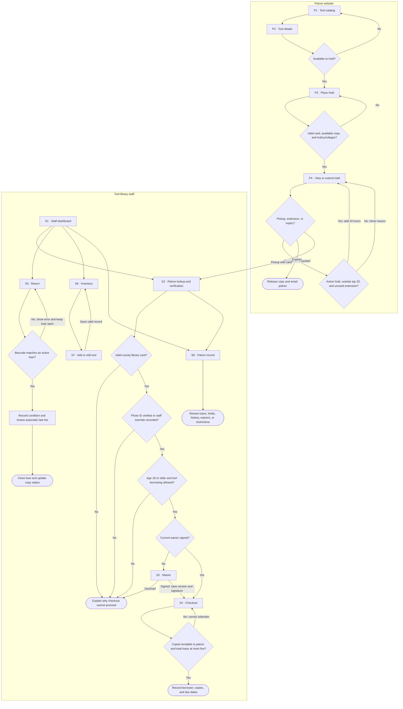

# Tool Lending Library UX Flow

## Rules and design assumptions

- Holds last 24 hours. Eligible holds can be extended once for another 24 hours. Tools in the top 20 by checkout frequency are ineligible. The design assumes patrons can open a hold-specific link to review or request an extension.
- Staff can start a walk-in checkout from the dashboard. The photo ID override follows Franklin's scenario. Staff still verify the library card, age, borrowing privileges, and waiver.
- Each copy has its own barcode. Checkout shows each copy's due date based on its lending period of up to two weeks. Staff can share safety resources when available.
- Return fees follow the initial Q&A: one-day grace period (or until closing on the next open day), then $1 per day for standard tools or $3 per day for high-demand or large tools, capped at the lower of $20 or replacement value. Cathy's scenario does not state how the grace period was applied. The wireframe uses the initial Q&A rule and leaves damage charges unspecified.
- The patron record supports individual hold limits, hold frequency limits, and tool borrowing restrictions. Unreturned tools can block further tool borrowing while book borrowing remains available. The Q&A gives both a general fee cap and a replacement-value example for unreturned tools, so the unreturned-item charge needs clarification.
- Location appears in catalog and inventory so additional tool branches can be added later.
